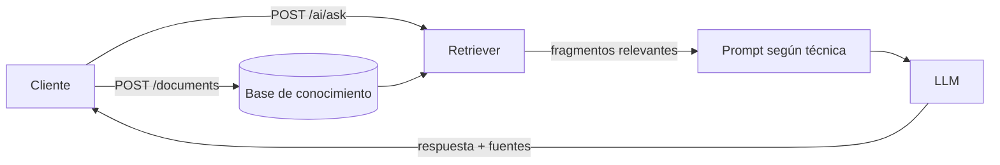

# API Proyecto Semestral — Base de conocimiento con RAG y LLM

API REST desarrollada con **FastAPI** que permite administrar una base de conocimiento de documentos
(CRUD) y hacerle preguntas en lenguaje natural a un **LLM** (OpenAI GPT-4o) mediante una arquitectura
**RAG** (Retrieval-Augmented Generation), aplicando tres técnicas de *prompt engineering*:
zero-shot, few-shot y chain-of-thought.

## Integrantes

| Nombre |
|---|
| Wilmer Capera |
| Santiago Santana |
| Esteban Salvador |

Proyecto semestral integrador — Universidad Manuela Beltrán (UMB).

## Tecnologías

| Componente | Herramienta |
|---|---|
| Framework web | FastAPI (Python 3.12) |
| Validación y esquemas | Pydantic v2 |
| Documentación | OpenAPI 3.0 (Swagger UI en `/docs`) |
| LLM | OpenAI GPT-4o (o un LLM simulado para pruebas) |
| Pruebas | pytest + TestClient |
| CI/CD | GitHub Actions |

## ¿Cómo funciona la API?

La API cumple dos funciones que trabajan juntas:

1. **Gestionar documentos (CRUD):** se crean, consultan, actualizan y eliminan documentos de texto.
2. **Responder preguntas sobre esos documentos (RAG):** el usuario pregunta algo, la API busca los
   fragmentos más relevantes entre los documentos guardados y se los entrega al LLM como contexto para
   que responda basándose únicamente en ellos.

### Flujo general



### Flujo del RAG paso a paso (`POST /ai/ask`)

1. **Recepción y validación:** se valida la pregunta (5 a 500 caracteres), la técnica y `top_k`.
2. **Fragmentación (chunking):** cada documento se divide en fragmentos de 80 palabras con 20 palabras
   de solape, para no perder ideas cortadas en el límite.
3. **Recuperación:** se normaliza el texto (minúsculas, sin tildes, sin palabras vacías) y se puntúa cada
   fragmento según cuántas palabras de la pregunta contiene. Se toman los `top_k` mejores.
4. **Sin contexto:** si ningún fragmento coincide, la API responde con un aviso y **no llama al LLM**
   (evita alucinaciones y gasto innecesario).
5. **Construcción del prompt:** se arma el mensaje con la técnica elegida.
6. **Generación:** se envía al LLM y se devuelve la respuesta junto con las `sources` utilizadas.

### Técnicas de prompt engineering

| Técnica | Valor de `technique` | Qué hace |
|---|---|---|
| Zero-shot | `zero_shot` | Instrucción directa con contexto y pregunta, sin ejemplos. |
| Few-shot | `few_shot` | Incluye ejemplos de pregunta/respuesta para fijar el formato `Respuesta / Fuente`. |
| Chain-of-Thought | `chain_of_thought` | Pide razonar en pasos (datos relevantes, relación con la pregunta, conclusión) antes de la "Respuesta final". |

### Manejo de errores

Todos los errores devuelven el mismo formato JSON:

```json
{ "status": 404, "error": "not_found", "message": "Document 999 not found", "path": "/documents/999" }
```

| Código | `error` | Cuándo ocurre |
|---|---|---|
| 404 | `not_found` | El documento no existe |
| 409 | `conflict` | Ya existe un documento con ese título |
| 422 | `validation_error` | Datos inválidos; incluye `details` con el campo y el problema |
| 500 | `internal_error` | Error inesperado (el detalle solo queda en el log) |
| 502 | `llm_unavailable` | El LLM falló o no está configurado |

## Endpoints

| Método | Ruta | Descripción | Respuestas |
|---|---|---|---|
| `POST` | `/documents` | Crear un documento | 201, 409, 422 |
| `GET` | `/documents` | Listar documentos (`skip`, `limit`) | 200, 422 |
| `GET` | `/documents/{id}` | Obtener un documento | 200, 404 |
| `PUT` | `/documents/{id}` | Reemplazar un documento | 200, 404, 409, 422 |
| `DELETE` | `/documents/{id}` | Eliminar un documento | 204, 404 |
| `POST` | `/ai/ask` | Preguntar a la base de conocimiento (RAG) | 200, 422, 502 |
| `GET` | `/health` | Estado del servicio | 200 |

Swagger UI en inglés (summary, description y ejemplos de cada JSON): **http://localhost:8000/docs**
(especificación cruda en `/openapi.json`).

### Ejemplo de uso

**1. Crear un documento**

```bash
curl -X POST http://localhost:8000/documents \
  -H "Content-Type: application/json" \
  -d '{
    "title": "Enrollment guide",
    "content": "To enroll, the student must pay the tuition fee and hand in the student ID card at the admissions office before the first day of classes.",
    "tags": ["admissions"]
  }'
```

**2. Hacer una pregunta**

```bash
curl -X POST http://localhost:8000/ai/ask \
  -H "Content-Type: application/json" \
  -d '{"question": "Where do I hand in my student ID card?", "technique": "few_shot", "top_k": 3}'
```

Respuesta:

```json
{
  "answer": "Answer: The student ID card must be handed in at the admissions office.\nSource: Enrollment guide.",
  "technique": "few_shot",
  "sources": [
    {
      "document_id": 1,
      "title": "Enrollment guide",
      "text": "To enroll, the student must pay the tuition fee and hand in the student ID card...",
      "score": 1.342
    }
  ]
}
```

## Instalación y ejecución

```bash
python -m venv .venv
source .venv/bin/activate          # Windows: .venv\Scripts\activate
pip install -r requirements.txt
uvicorn app.main:app --reload
```

La API queda disponible en `http://localhost:8000`.

## Configuración del LLM

| Variable | Valor por defecto | Descripción |
|---|---|---|
| `LLM_PROVIDER` | `fake` | `fake` (respuestas simuladas, sin costo) u `openai` |
| `OPENAI_API_KEY` | vacío | Clave de OpenAI (obligatoria si `LLM_PROVIDER=openai`) |
| `OPENAI_MODEL` | `gpt-4o` | Modelo a utilizar |

```bash
export LLM_PROVIDER=openai
export OPENAI_API_KEY=sk-...
```

> Con `LLM_PROVIDER=fake`, las respuestas empiezan con `[FAKE-LLM]`. Se usa en las pruebas y en el CI.
> **Nunca** subas tu API key al repositorio.

## Pruebas

```bash
pytest -v
```

Las pruebas de integración recorren la API completa (HTTP → servicio → repositorio) con el LLM simulado:

1. Ciclo CRUD completo: crear, leer, listar, actualizar, eliminar y verificar el 404.
2. Manejo de errores: 422 por validación, 409 por título duplicado y 404 con formato uniforme.
3. RAG con las tres técnicas de prompt, y respuesta sin contexto.

## Arquitectura

El código está organizado en capas, y cada una solo depende de la inferior:

```
app/
├── main.py                   # create_app(): ensambla la aplicación
├── container.py              # crea y conecta las dependencias
├── core/                     # configuración y manejo de excepciones
├── domain/document.py        # entidad Document
├── schemas/                  # modelos Pydantic de entrada y salida
├── repositories/             # acceso a datos (abstracción + implementación en memoria)
├── services/
│   ├── document_service.py   # reglas de negocio del CRUD
│   ├── rag_service.py        # fragmentación, recuperación y generación
│   └── llm/
│       ├── client.py         # clientes LLM (OpenAI y simulado)
│       └── prompts.py        # zero-shot, few-shot y chain-of-thought
└── api/
    ├── dependencies.py       # inyección de dependencias
    ├── docs.py               # ejemplos reutilizables para OpenAPI
    └── routes/               # documents.py (CRUD) y ai.py (RAG)
tests/test_integration.py
```

**Principios y patrones aplicados:** responsabilidad única, inyección de dependencias, patrón Repository
(cambiar a una base de datos real solo requiere una nueva implementación), patrón Strategy (técnicas de
prompt y proveedores de LLM intercambiables) y patrón Factory (`create_app`, `build_llm_client`).

## CI/CD

El workflow `.github/workflows/ci.yml` instala las dependencias y ejecuta `pytest` en cada *push* y
*pull request*, siempre con `LLM_PROVIDER=fake` para no consumir la API real.

## Limitaciones y mejoras futuras

- Los documentos se guardan **en memoria**: se pierden al reiniciar el servidor.
  Mejora: implementar el repositorio con una base de datos (PostgreSQL + SQLAlchemy).
- La recuperación busca por **coincidencia de palabras**, por lo que no reconoce sinónimos.
  Mejora: usar *embeddings* con una base vectorial (Chroma, pgvector o FAISS).
- Solo hay un proveedor de LLM real (OpenAI). Mejora: añadir Gemini como otra implementación de `LLMClient`.

## Bitácora de GitHub Copilot

Las sugerencias de Copilot evaluadas y las correcciones realizadas se documentan en
[`COPILOT_LOG.md`](COPILOT_LOG.md).
